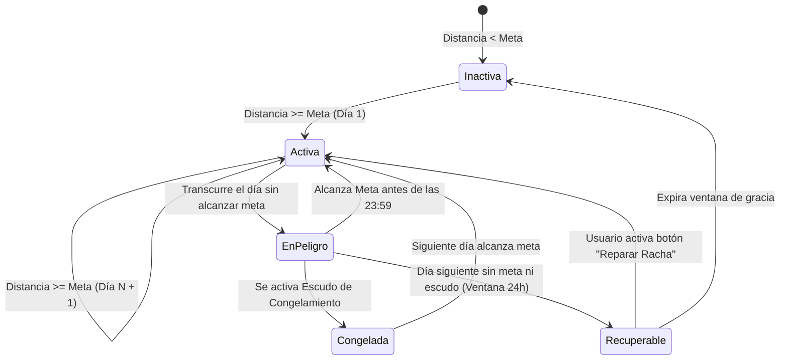
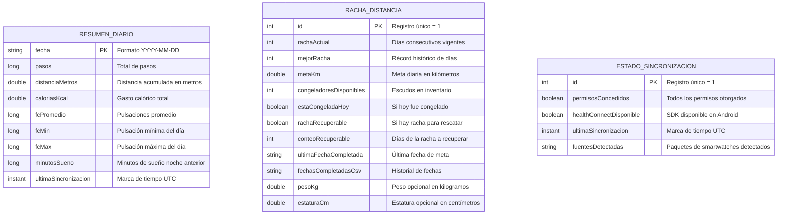

# Manual de Arquitectura y Diseño Técnico
**Proyecto:** Health — Sistema de Salud para Smartwatch  
**Institución:** Universidad Tecnológica de Nezahualcóyotl (UTN) — ITIC-901  
**Materia:** Desarrollo para dispositivos inteligentes  

---

## 1. Visión General de la Arquitectura

La aplicación adopta los principios de **Clean Architecture** complementados con el patrón de presentación **MVVM (Model-View-ViewModel)** y **flujo unidireccional de datos (UDF)**. El propósito fundamental de esta arquitectura es mantener la lógica de negocio y las reglas de dominio completamente independientes de los SDKs de fabricantes específicos (Samsung, Google, Garmin) y de los detalles del framework de Android.

```mermaid
graph TD
    subgraph Presentación (UI Layer)
        ComposeScreens["Pantallas Jetpack Compose (Material 3)"]
        CanvasWidgets["Componentes Canvas (Barras, Línea FC, Llama)"]
        VM["ViewModels (Dashboard, History, HeartRate, Streak, Connection)"]
        StateFlows["StateFlow / Flujo Unidireccional (UDF)"]
    end

    subgraph Dominio (Domain Layer - Negocio Puro)
        UseCases["Casos de Uso (GetSummary, GetHistory, ManageStreak, CheckConn)"]
        DomainModels["Modelos (DailySummary, StreakState, HistoryPoint)"]
        ProviderInterface["Interfaz HealthConnectionProvider"]
    end

    subgraph Datos (Data Layer)
        RepoImpl["HealthRepositoryImpl"]
        HCDataSource["HealthConnectDataSource"]
        DeviceResolver["HealthDeviceResolver (Agnóstico)"]
        RoomDB[("Room Database SQLite (Caché & Rachas)")]
    end

    ComposeScreens -->|Eventos de Usuario| VM
    VM -->|Expone Estado Inmutable| StateFlows
    StateFlows -->|Re-renderiza UI| ComposeScreens
    VM -->|Invoca| UseCases
    UseCases -->|Consulta| DomainModels
    UseCases -->|Depende de| RepoImpl
    RepoImpl -->|Implementa Provider| ProviderInterface
    RepoImpl -->|Sincroniza| HCDataSource
    RepoImpl -->|Persistencia Offline| RoomDB
    HCDataSource -->|Identifica Fuentes| DeviceResolver
```

---

## 2. Patrones de Diseño Implementados

### 2.1. Patrón Provider / Abstracción de Fuentes (`HealthConnectionProvider`)
Para evitar que el dominio y la presentación dependan directamente de la biblioteca `androidx.health.connect:connect-client`, se definió una interfaz abstracta en el dominio. De este modo, en pruebas unitarias o en futuras iteraciones, es trivial reemplazar Health Connect por un cliente simulado (*mock*) o un emulador BLE sin alterar una sola línea de la interfaz gráfica.

### 2.2. Patrón Multi-Dispositivo Agnóstico (`HealthDeviceResolver`)
Android Health Connect consolida datos de múltiples aplicaciones que interactúan con wearables. El componente `HealthDeviceResolver`:
1. Inspecciona los metadatos de origen `Record.metadata.dataOrigin.packageName`.
2. Mapea identificadores como `com.sec.android.app.shealth` (Samsung Galaxy Fit 3), `com.fitbit.FitbitMobile` (Pixel Watch), o `com.garmin.android.apps.connectmobile`.
3. Ofrece al usuario total transparencia sobre cuál wearable o aplicación está suministrando la información médica en el teléfono.

### 2.3. Patrón Repositorio con Fallback Offline (Room SQLite)
La aplicación cumple estrictamente con el requerimiento **RF-10 / HU-10** (funcionamiento sin conexión):
* Al solicitar el resumen diario, primero se emite el último estado guardado en SQLite local.
* En segundo plano, se consulta Health Connect. Si la lectura es exitosa, se actualiza Room y se re-emite la versión fresca.
* Si el teléfono no tiene Health Connect disponible, los permisos fueron revocados temporalmente o el usuario no tiene conexión, la app no se cierra (*crash-free*) y muestra un aviso visual de **"Modo sin conexión - Datos en caché"**.

---

## 3. Motor de Rachas Gamificadas (Estilo Duolingo / TikTok)

El sistema de rachas estimula el cumplimiento del objetivo físico diario de distancia.



### Reglas de Negocio del Motor de Rachas
1. **Meta de Distancia Diaria:** Configurable en kilómetros (por defecto 3.0 km; opciones rápidas: 2 km, 3 km, 5 km, 8 km, 10 km).
2. **Incremento de Racha:** Al detectar que la distancia registrada hoy $\ge \text{meta}$, y el día de ayer fue cumplido (o estuvo congelado), la racha se incrementa en $+1$.
3. **Escudo de Congelamiento (*Streak Freeze*):**
   * El usuario cuenta con un inventario de escudos (máximo inicial: 2).
   * Al activar un escudo, el día actual queda protegido contra reseteos si no se puede salir a caminar o correr.
   * Por cada 7 días de racha consecutivos, el usuario recibe 1 nuevo escudo de recompensa.
4. **Ventana de Recuperación (*Streak Repair*):**
   * Si el usuario olvida caminar y no tenía escudos activos, la racha pasa al estado `isStreakRecoverable`.
   * Durante una ventana de gracia de 24 horas, el usuario puede presionar el botón de reparación para restaurar sus días acumulados sin penalización.
5. **Recomendación Inteligente de Meta por IMC (Opcional):**
   * El usuario puede suministrar de forma voluntaria su peso (kg) y estatura (cm).
   * La app calcula el Índice de Masa Corporal ($IMC = \frac{\text{peso}}{\text{estatura}^2}$) y clasifica al usuario según directrices de la OMS.
   * Sugiere una meta de distancia diaria fisiológicamente apropiada (2.5 km a 5.0 km) y permite aplicarla a la racha con un solo toque.

---

## 4. Esquema de Base de Datos Local (Room SQLite)



---

## 5. Estrategias de Consulta en Health Connect

| Operación | Método Health Connect | Justificación Técnica |
| :--- | :--- | :--- |
| **Resumen Diario** | `client.aggregate(...)` | Calcula totales y promedios directamente en el sistema operativo; evita sobrecostos de memoria y **resuelve automáticamente la deduplicación de fuentes concurrentes**. |
| **Ventana Nocturna de Sueño** | `client.aggregate(...)` (desde las 18:00 del día anterior) | El sueño inicia habitualmente antes de las 00:00. Medir solo el día actual cortaría la fase previa a medianoche. El resultado se asocia al día en que el usuario despierta. |
| **Historial (7 y 30 Días)** | `client.aggregateGroupByPeriod(..., Period.ofDays(1))` | Agrupa datos por cubetas de 24 horas para alimentar de forma directa el gráfico de barras. |
| **Frecuencia Cardíaca Continua** | `client.readRecords(HeartRateRecord)` con `pageToken` | Para graficar la curva del día con Canvas se requieren los puntos discretos en el tiempo (`HeartRateSample`), recorriendo la paginación hasta agotar registros. |
