# Manual de Vinculación de Dispositivos y Sincronización
**Proyecto:** Health — Sistema de Salud para Smartwatch  
**Institución:** Universidad Tecnológica de Nezahualcóyotl (UTN) — ITIC-901  
**Dispositivos Clave:** Samsung Galaxy Fit 3 & Google Pixel 9a  
**Arquitectura de Datos:** Multi-Dispositivo Agnostic Pattern vía Android Health Connect  

---

## 1. Arquitectura del Flujo de Datos

El smartwatch Samsung Galaxy Fit 3 funciona con FreeRTOS (sistema operativo ligero para pulseras inteligentes) en lugar de Wear OS, lo que significa que no admite instalación directa de aplicaciones de terceros en el reloj ni expone un protocolo Bluetooth estándar abierto.

Para superar esta limitación con una arquitectura moderna, oficial y limpia, la aplicación implementa el siguiente flujo de información:

```mermaid
flowchart LR
    A["Samsung Galaxy Fit 3 (Muñeca)"] -->|Bluetooth BLE Propietario| B["Galaxy Wearable (Pixel 9a)"]
    B -->|Base de Datos Interna| C["Samsung Health (Pixel 9a)"]
    C -->|Escritura de Registros| D["Android Health Connect (API del Sistema)"]
    D -->|Lectura Agregada con Deduplicación| E["App Health (Nuestra Aplicación)"]
    E -->|Caché Local Offline & Rachas| F[("Room SQLite")]
```

---

## 2. Configuración Paso a Paso: Samsung Galaxy Fit 3 + Google Pixel 9a

### Paso 1: Instalación de Aplicaciones de Soporte de Samsung
En tu Google Pixel 9a, descarga desde Google Play Store:
1. **Galaxy Wearable (Samsung Gear)**
2. **Galaxy Fit3 Plugin** (se solicitará automáticamente al abrir Galaxy Wearable)
3. **Samsung Accessory Service**
4. **Samsung Health**

### Paso 2: Vinculación del Reloj
1. Enciende tu Galaxy Fit 3.
2. Abre **Galaxy Wearable** en tu Pixel 9a.
3. Selecciona tu **Galaxy Fit3** de la lista de dispositivos Bluetooth encontrados y confirma el código numérico en ambas pantallas.
4. Concede los permisos de notificaciones y Bluetooth solicitados por Android.

### Paso 3: Conexión entre Samsung Health y Health Connect
Este paso es **crucial** para que los datos del reloj lleguen al sistema Android:
1. Abre la aplicación **Samsung Health** en tu Pixel 9a.
2. Ve a tu **Perfil** o pulsa los tres puntos verticales en la esquina superior derecha y selecciona **Ajustes**.
3. Busca la opción **Health Connect** (o *Conectar con Health Connect*).
4. Activa la sincronización. Aparecerá la ventana oficial de Health Connect solicitando permisos.
5. Selecciona **"Permitir todo"** o asegúrate de marcar con permiso de **Escritura**:
   * Pasos (*Steps*)
   * Distancia (*Distance*)
   * Calorías quemadas en total (*Total Calories Burned*)
   * Frecuencia cardíaca (*Heart Rate*)
   * Sueño (*Sleep Session*)
6. Pulsa **Listo**. A partir de este momento, cada vez que Samsung Health sincronice con tu reloj Fit 3, escribirá automáticamente los datos en Health Connect.

### Paso 4: Autorización en la Aplicación "Health"
1. Abre nuestra aplicación **Health** en tu Pixel 9a.
2. Al abrir por primera vez o desde la pantalla de bienvenida/estado, pulsa **"Conceder Permisos de Salud"**.
3. El sistema Android mostrará la ventana de permisos de Health Connect.
4. Concede los permisos de lectura solicitados.
5. ¡Listo! Las métricas comenzarán a reflejarse en tiempo real en tu Dashboard.

---

## 3. Patrón Multi-Dispositivo: ¿Qué pasa si cambio de reloj o de teléfono?

Uno de los requerimientos centrales de este desarrollo es que **el sistema no quede atado exclusivamente al Galaxy Fit 3**. Gracias al patrón arquitectónico desacoplado, la app es completamente agnóstica al hardware:

### ¿Cómo funciona el soporte para otros relojes?
Android Health Connect actúa como una base de datos centralizada de salud compartida por todas las marcas. Por lo tanto, si en el futuro cambias a otro wearable:

| Reloj / Smartwatch | Aplicación Puente | Configuración requerida |
| :--- | :--- | :--- |
| **Google Pixel Watch 1/2/3** | Fitbit App | Ajustes > Conectar con Health Connect > Activar escritura. |
| **Garmin (Forerunner, Venu, Fénix)** | Garmin Connect | Ajustes de cuenta > Aplicaciones conectadas > Health Connect. |
| **Xiaomi Band / Redmi Watch** | Mi Fitness | Perfil > Datos de terceros > Health Connect. |
| **Amazfit (GTR, GTS, T-Rex)** | Zepp App | Perfil > Cuentas vinculadas > Health Connect. |
| **Huawei Watch (GT / Fit)** | Huawei Health + Health Sync | Mediante la app puente *Health Sync* hacia Health Connect. |
| **Anillos Inteligentes (Oura, Ultrahuman)** | Oura / Ultrahuman App | Ajustes > Integraciones > Health Connect. |

Nuestra clase `HealthDeviceResolver` analiza el origen del paquete (`Record.metadata.dataOrigin.packageName`) para identificar qué dispositivo está enviando la información y mostrarlo en la sección de **"Estado de Conexión"**, sin que el usuario tenga que reprogramar o ajustar nada en la aplicación.

---

## 4. Solución de Problemas de Sincronización y Retardo

### A. "El reloj muestra pasos pero la app no los actualiza"
1. **Verificar Samsung Health:** Abre Samsung Health y desliza hacia abajo en la pantalla principal para forzar la sincronización BLE entre el reloj y el teléfono.
2. **Revisar Optimización de Batería en Pixel 9a:**
   * Ve a **Ajustes** > **Aplicaciones** > **Samsung Health** > **Batería**.
   * Elige la opción **"Sin restricciones"** para evitar que Android suspenda la sincronización en segundo plano.
3. **Pulsar el botón de recarga en Health:** En nuestra app, toca el icono de recarga junto a la hora de sincronización en el encabezado del Dashboard.

### B. "La tarjeta de sueño muestra 'Sin datos'"
Health Connect requiere que la sesión de sueño se complete y sea registrada. Como las sesiones inician la noche anterior, la app consulta el rango desde las 18:00 del día previo. El dato aparecerá una vez que despiertes y Samsung Health procese el análisis del sueño.
